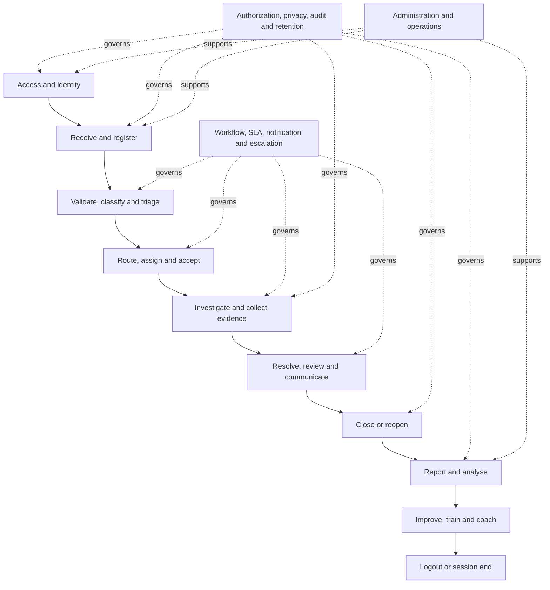
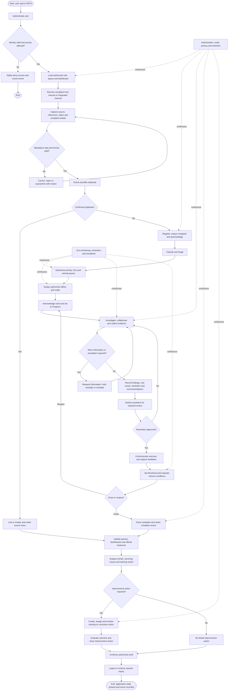
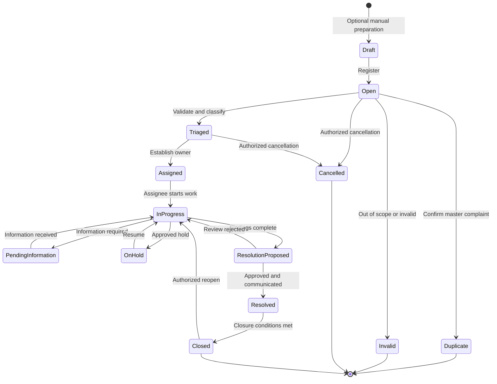
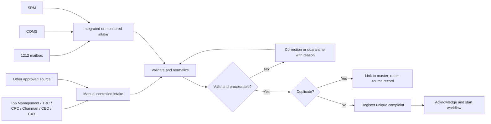
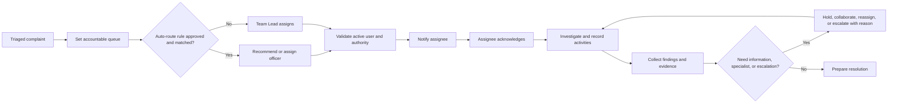
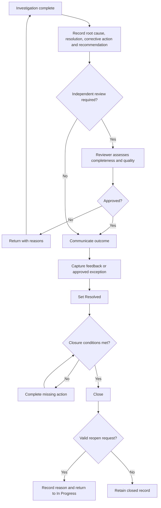
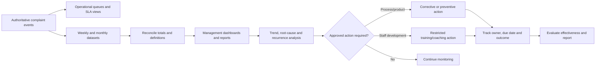
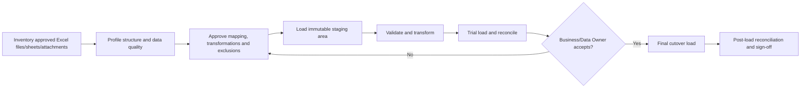

# Complaint Management and Tracking System

## End-to-End Process Map and Requirement Analysis

### Greenfield Target Operating Process

`CMTS-PMAP-001` &nbsp;|&nbsp; `Version 0.1` &nbsp;|&nbsp; `DRAFT`

---

> [!IMPORTANT]
> This document defines the required **future-state business process**. It intentionally does not assess, reuse, or constrain the process around the current ComTrack implementation. The supplied BRD is the business source; controls needed to make the process secure, auditable, testable, and operationally complete are clearly labelled **PROPOSED** and require stakeholder approval.

## Document control

| Attribute | Details |
|---|---|
| Document title | Complaint Management and Tracking System — End-to-End Process Map and Requirement Analysis |
| Document ID | CMTS-PMAP-001 |
| Version | 0.1 |
| Status | Draft for process validation workshops |
| Prepared date | 26 September 2026 |
| Business area | SLT Contact Centre |
| Process owner | Product Owner / Contact Centre Operations — TBD |
| Maintainer | Technical Business Analyst |
| Approval authority | Business Sponsor — TBD |
| Primary source | Business Requirement of the Complaint Management and Tracking System for Contact Centre |
| Related documents | [High-Level Requirements](./high-level-requirements.md) · [System Requirements Specification](./system-requirements-specification.md) · [Requirements Traceability Matrix](./requirements-traceability-matrix.md) · [Roles and Lifecycle](./roles-permissions-and-lifecycle.md) · [Decision Register](./decision-register.md) |

## Contents

1. [Purpose and analysis boundary](#1-purpose-and-analysis-boundary)
2. [Source and requirement conventions](#2-source-and-requirement-conventions)
3. [Business outcomes](#3-business-outcomes)
4. [Actors and process ownership](#4-actors-and-process-ownership)
5. [End-to-end process architecture](#5-end-to-end-process-architecture)
6. [Level 1 end-to-end process map](#6-level-1-end-to-end-process-map)
7. [Detailed process and requirement analysis](#7-detailed-process-and-requirement-analysis)
8. [Complaint lifecycle and control gates](#8-complaint-lifecycle-and-control-gates)
9. [Detailed sub-process maps](#9-detailed-sub-process-maps)
10. [Alternative and exception flows](#10-alternative-and-exception-flows)
11. [Cross-cutting control requirements](#11-cross-cutting-control-requirements)
12. [Information created through the process](#12-information-created-through-the-process)
13. [BRD process coverage](#13-brd-process-coverage)
14. [End-to-end acceptance scenarios](#14-end-to-end-acceptance-scenarios)
15. [Decisions required to approve the process](#15-decisions-required-to-approve-the-process)
16. [Process validation and sign-off](#16-process-validation-and-sign-off)

---

## 1. Purpose and analysis boundary

This document provides a single, workshop-ready view of how the requested Complaint Management and Tracking System shall operate from the moment a user attempts to sign in until complaint work is completed, reported, converted into improvement activity where appropriate, and the user signs out.

It is designed to answer six questions for every part of the process:

1. Who performs the activity?
2. What triggers it and what information is required?
3. What must the system do?
4. What business decision or rule controls the outcome?
5. What record, status, notification, or audit evidence is produced?
6. How will stakeholders prove that the requirement works end to end?

### 1.1 Included process boundary

- Enterprise authentication, session establishment, and role-based landing page.
- Complaint receipt through all BRD channels.
- Registration, validation, source-reference preservation, and acknowledgement.
- Categorization, triage, prioritization, service target selection, and routing.
- Queue ownership, assignment, acknowledgement, reassignment, and escalation.
- Investigation, collaboration, findings, voice recordings, and other proof.
- Status, SLA, reminder, escalation, and complete timeline management.
- Root cause, resolution, corrective action, stakeholder recommendation, and feedback.
- Review, approval, resolution, closure, rejection, cancellation, duplicate treatment, and reopening.
- Search, operational queues, management dashboards, weekly/monthly reporting, and trend analysis.
- Recurring-issue detection and linked staff training/coaching actions.
- Administration, audit, operational support, and controlled logout/session expiry.
- Historical Excel migration as a separate pre-go-live process.

### 1.2 Boundary exclusions

The process does not define replacement workflows for CQMS, SRM, email, ERP/directory, telephony, or voice-recording platforms. Those systems remain external participants unless stakeholders approve a wider scope.

## 2. Source and requirement conventions

| Label | Meaning |
|---|---|
| **BRD** | Explicit business need or process element stated in the supplied BRD. |
| **PROPOSED** | Required to provide secure and complete service-desk operation but not sufficiently specified by the BRD. Stakeholder approval is required. |
| **TBD** | A policy, value, owner, rule, or interface that must be decided before the affected process can be baselined. |

The BRD explicitly establishes the business chain from complaint receipt to resolution, reporting, and training. It does not fully define authentication, roles, duplicate handling, priority, SLA, intermediate statuses, approval rules, reopening, audit, retention, or exception recovery. Those controls are included as proposed requirements so that the process is genuinely end to end rather than a happy-path screen sequence.

## 3. Business outcomes

| Outcome ID | Required business outcome | Source |
|---|---|---|
| OUT-01 | Every received complaint is either registered and traceable or rejected/quarantined with an explainable outcome. | BRD/PROPOSED |
| OUT-02 | Every active complaint has an accountable team/queue and visible handling status. | BRD/PROPOSED |
| OUT-03 | Investigation findings and supporting evidence are available to authorized decision-makers. | BRD |
| OUT-04 | Resolutions, feedback, and stakeholder recommendations are consistently recorded. | BRD |
| OUT-05 | Management can monitor volumes, trends, timelines, recurring issues, and ownership without manual spreadsheet consolidation. | BRD |
| OUT-06 | Qualifying complaint findings result in controlled training/coaching or improvement actions. | BRD/PROPOSED |
| OUT-07 | Sensitive customer, complaint, employee, and evidence information is protected and every material action is attributable. | PROPOSED |
| OUT-08 | Historical Excel records are migrated or explicitly excluded with reconciliation and approval. | BRD/PROPOSED |

## 4. Actors and process ownership

| Actor | Primary process responsibility | Typical process stages |
|---|---|---|
| Identity Provider | Authenticate the user and provide trusted identity claims. | P01, P26 |
| Complaint Intake Agent | Register and validate complaints received through manual channels. | P03–P08 |
| Source Integration | Deliver complaints from email, CQMS, SRM, or other approved systems. | P03–P08 |
| Triage Officer | Validate scope, classify, prioritize, select SLA, and route. | P09–P10A |
| Team Lead/Supervisor | Own queues, assign work, monitor service risk, escalate, and review outcomes. | P10A–P16 |
| Handling/Investigation Officer | Accept ownership, investigate, record evidence/findings, and propose resolution. | P11–P15 |
| Quality/Resolution Reviewer | Validate investigation completeness and resolution quality. | P16–P19 |
| Reporting/Management User | Monitor operational performance and management trends. | P20–P21 |
| Training/Coaching Officer | Assess approved findings and manage linked development actions. | P22–P24 |
| System Administrator | Manage controlled configuration, roles, taxonomies, routing, SLA, and report definitions. | SP-01 |
| Auditor/Read-only User | Review authorized case and immutable audit evidence. | SP-02 |
| IT Operations/Support | Monitor availability, integrations, jobs, recovery, and support. | SP-03 |
| Data Migration Team | Profile, transform, load, reconcile, and obtain approval for historical data. | MP-01–MP-08 |

> [!NOTE]
> Actor names are role concepts, not final job titles. One employee may hold multiple compatible roles, subject to approved segregation-of-duties rules.

## 5. End-to-end process architecture

### 5.1 Value streams

| Value stream | Start event | End event | Business value |
|---|---|---|---|
| VS-01 Access | User opens CMTS | Authorized workspace displayed or access safely denied | Only approved users enter the process |
| VS-02 Intake | Complaint arrives | Registered complaint with unique number and source trace | No valid complaint is lost or silently duplicated |
| VS-03 Handling | Registered complaint awaits triage | Approved resolution is communicated | Accountable and evidence-based handling |
| VS-04 Closure | Resolution is approved | Complaint closes or reopens | Controlled completion with retained history |
| VS-05 Insight | Authoritative lifecycle data changes | Reconciled operational/management insight is available | Timely control and decision support |
| VS-06 Improvement | Recurring issue or training need is approved | Improvement/training action is completed and evaluated | Complaint learning results in action |
| VS-07 Migration | Approved legacy extract is received | Reconciled migrated baseline is accepted | Historical continuity at go-live |

## 6. Level 1 end-to-end process map

## 7. Detailed process and requirement analysis

### 7.1 Access and session

| ID | Activity and actor | Required input/rule | System behaviour and output | Requirement trace | Source |
|---|---|---|---|---|---|
| P01 | User authenticates | Approved SLT identity; active account | Validate identity through approved provider; reject invalid/inactive access; do not accept employee number alone as authentication | HLR-22; FR-IAM-001–003, FR-IAM-011 | PROPOSED |
| P02 | System establishes workspace | Trusted identity, role, team, queue, confidentiality scope | Load only authorized menus, queues, records, actions, reports, and administration functions | HLR-15, HLR-22; FR-IAM-004–008 | PROPOSED/TBD |
| P02A | System starts session controls | Approved idle/absolute lifetime and token policy | Apply session timeout and reauthentication; record authentication/authorization events without tokens | FR-IAM-009, FR-IAM-012 | PROPOSED/TBD |

### 7.2 Complaint receipt and registration

| ID | Activity and actor | Required input/rule | System behaviour and output | Requirement trace | Source |
|---|---|---|---|---|---|
| P03 | Agent/integration receives complaint | Top Management, TRC, CRC, 1212 email, SRM, CQMS, Chairman/CEO/CXX, or approved Other source | Accept manual or integrated intake and identify receipt channel separately from origin | HLR-02–03; FR-INTAKE-001–003 | BRD/PROPOSED |
| P04 | Agent/integration captures complaint | Source reference, receipt time, summary, description, applicable complainant/customer/service information | Validate mandatory fields, formats, controlled values, and timestamp consistency on the server | HLR-01, HLR-04; FR-INTAKE-004–011 | BRD/PROPOSED/TBD |
| P05 | Agent/integration handles invalid intake | Validation error or incomplete integrated message | Permit correction for manual intake; quarantine/retry integrated intake; retain reason and source trace | FR-INTAKE-010–011, FR-INTG-011–019 | PROPOSED |
| P06 | Agent/system evaluates duplicates | Approved exact and similarity indicators | Present possible matches for human decision; retries must be idempotent | FR-INTAKE-014, FR-INTAKE-018 | PROPOSED |
| P07 | Authorized user confirms duplicate | Master complaint and reason | Link duplicate to master without deleting the received record or external reference | HLR-14; FR-INTAKE-015, FR-WFL-014 | PROPOSED |
| P08 | System registers complaint | Valid non-duplicate intake | Generate unique complaint number, set initial status Open, preserve source payload/reference, acknowledge registration, and start timeline | HLR-01, HLR-04; FR-INTAKE-004–006, FR-INTAKE-016–020 | BRD/PROPOSED |

### 7.3 Classification, triage, routing, and ownership

| ID | Activity and actor | Required input/rule | System behaviour and output | Requirement trace | Source |
|---|---|---|---|---|---|
| P09 | Triage Officer classifies complaint | Complaint content and approved taxonomy | Capture category/subcategory including billing, faults, telesales, VAS, officer performance, and other approved issues | HLR-05; FR-TRIAGE-001–005 | BRD/PROPOSED |
| P10 | Triage Officer/system prioritizes | Approved impact, urgency, priority, SLA, calendar, and override rules | Calculate/recommend priority and targets; allow only authorized reason-coded override | HLR-06; FR-TRIAGE-006–012, FR-WFL-006–010 | PROPOSED/TBD |
| P10A | System routes to owning queue | Classification, source, service, organization, priority, and routing rules | Establish one accountable queue; expose unassigned work to authorized Team Leads | HLR-07; FR-ASGN-001–005, FR-ASGN-011 | BRD/PROPOSED |
| P11 | Team Lead/system assigns officer | Active authorized employee and capacity/skill rules | Set primary assignee, record ownership change, notify assignee, and retain full history | HLR-07–08; FR-ASGN-004–009 | BRD/PROPOSED |
| P12 | Officer acknowledges work | Valid assignment | Confirm ownership/start work; transition from Open/Assigned to In Progress and record actor/time | HLR-09–10; FR-WFL-001–005 | BRD/PROPOSED |

### 7.4 Investigation, evidence, and service control

| ID | Activity and actor | Required input/rule | System behaviour and output | Requirement trace | Source |
|---|---|---|---|---|---|
| P13 | Officer investigates | Complaint facts, authorized systems, customer/service context | Record activities, findings, notes, contact attempts, and investigation dates | HLR-11; FR-INV-001–005 | BRD/PROPOSED |
| P13A | Officer adds evidence | Approved documents, screenshots, correspondence, voice recordings, or secure references | Validate, protect, classify, link, authorize, and audit evidence access | HLR-12, HLR-27; FR-INV-006–014 | BRD/PROPOSED |
| P13B | Officer collaborates | Approved collaborator/specialist | Permit controlled contribution without transferring accountability unless formally reassigned | FR-ASGN-003, FR-INV-015 | PROPOSED/TBD |
| P14 | Officer/Team Lead manages exception | Missing information, wrong owner, specialist need, SLA risk, or policy condition | Request information, apply approved hold, reassign, forward, delegate, or escalate with reason and history | HLR-08, HLR-16; FR-ASGN-009–015, FR-WFL-009–014 | BRD/PROPOSED/TBD |
| P14A | System monitors service targets | Active complaint, SLA clock, warning/breach rules | Display remaining time, send deduplicated reminders, timestamp breach, and escalate to approved recipients | HLR-06, HLR-16; FR-WFL-011–013, FR-NOTIF-001–010 | PROPOSED/TBD |

### 7.5 Resolution, review, feedback, and closure

| ID | Activity and actor | Required input/rule | System behaviour and output | Requirement trace | Source |
|---|---|---|---|---|---|
| P15 | Officer proposes outcome | Investigation complete | Record findings, root cause, resolution, corrective/preventive action, and stakeholder recommendation | HLR-13; FR-INV-016–018, FR-RES-001–006 | BRD/PROPOSED |
| P16 | Reviewer assesses resolution | Completeness rules and approval policy | Approve, reject for rework, or request more information; retain reviewer, decision, time, and reason | FR-RES-007–009 | PROPOSED/TBD |
| P17 | Authorized user communicates outcome | Approved resolution and communication template/channel | Record communication, recipient, timestamp, delivery outcome, and feedback or approved no-feedback reason | HLR-13; FR-RES-010–012 | BRD/PROPOSED/TBD |
| P18 | System/user resolves complaint | Resolution approval and mandatory resolution fields | Transition to Resolved; stop or finalize resolution measurement according to approved policy | HLR-09, HLR-13; FR-WFL-015, FR-RES-001–012 | BRD/PROPOSED/TBD |
| P19 | Authorized user closes complaint | Closure checklist, final classification, communication/feedback, no blocking action | Transition to Closed; preserve complete immutable timeline and prevent normal hard deletion | HLR-14, HLR-23; FR-WFL-015, FR-WFL-019–020, FR-RES-013–016 | PROPOSED/TBD |
| P19A | Authorized user reopens complaint | Valid reopen window/authority and reason | Restore active ownership, record prior closure, recalculate SLA under approved rule, and return to In Progress | HLR-14; FR-WFL-016–017 | PROPOSED/TBD |

### 7.6 Reporting, analysis, and improvement

| ID | Activity and actor | Required input/rule | System behaviour and output | Requirement trace | Source |
|---|---|---|---|---|---|
| P20 | System refreshes operational views | Authoritative complaint events | Update role-scoped queues, aging, status, ownership, SLA, and workload measures | HLR-15, HLR-17; FR-SRCH-001–012, FR-RPT-001–007 | BRD/PROPOSED |
| P21 | Management/Quality analyses performance | Approved KPI definitions, filters, population, exclusions, and time basis | Produce weekly/monthly trends, resolution timelines, recurring issues, bottlenecks, and drill-down | HLR-17–19; FR-RPT-001–013 | BRD/PROPOSED/TBD |
| P22 | Quality/Training creates improvement action | Approved complaint finding or recurring pattern | Link training/coaching/corrective action to supporting complaints without exposing unnecessary confidential data | HLR-19–20; FR-TRN-001–006 | BRD/PROPOSED/TBD |
| P23 | Training/Action Owner manages action | Owner, action, due date, confidentiality, expected outcome | Track status, evidence, reminder/escalation, completion, and overdue state | FR-TRN-004–009 | PROPOSED/TBD |
| P24 | Quality/Management evaluates effectiveness | Completed action and agreed measure | Record outcome and review whether issue/rate improved; close or extend action | FR-TRN-010, FR-RPT-012–013 | PROPOSED/TBD |

### 7.7 Session end

| ID | Activity and actor | Required input/rule | System behaviour and output | Requirement trace | Source |
|---|---|---|---|---|---|
| P25 | User continues authorized work | Active valid session | Preserve authorized work context without using client state as the security decision | FR-IAM-003–005, FR-IAM-009 | PROPOSED |
| P26 | User/system ends session | Explicit logout, idle timeout, absolute timeout, account revocation, or authentication failure | Clear application state, invoke approved identity logout/reauthentication behaviour, and record safe event | HLR-22; FR-IAM-009, FR-IAM-012 | PROPOSED/TBD |

### 7.8 Supporting administration and operational processes

| ID | Activity and actor | Required input/rule | System behaviour and output | Requirement trace | Source |
|---|---|---|---|---|---|
| SP-01 | Administrator manages controlled configuration | Approved roles, taxonomies, routing, SLA, templates, integrations, and report definitions | Validate, effective-date, version, authorize, and audit configuration changes without rewriting historical meaning | HLR-21; FR-ADM-001–014 | PROPOSED/TBD |
| SP-02 | Auditor reviews process evidence | Approved audit scope and access | Search and export authorized immutable security/business events while preventing alteration or deletion | HLR-23; FR-AUD-001–012 | PROPOSED |
| SP-03 | IT Operations monitors service | Approved health, metric, alert, support, and escalation thresholds | Monitor availability, errors, integration queues, scheduled jobs, storage, backup, and audit-pipeline health | HLR-28; NFR-OPS-001–008 | BRD/PROPOSED/TBD |
| SP-04 | Support team handles incident/request | Named support ownership, severity, response/restore targets, runbook, and change authority | Diagnose and recover without unauthorized direct data change; record incident, action, outcome, and linkage | HLR-28; NFR-MNT-001–011, NFR-AVL-001–008 | BRD/PROPOSED/TBD |
| SP-05 | Records/Security applies retention control | Approved schedule, legal hold, archive, and disposal authority | Retain, hold, archive, and dispose of complaint-related objects consistently and audibly | HLR-27; HNFR-12 | PROPOSED/TBD |

### 7.9 Historical migration process

| ID | Activity and actor | Required input/rule | System behaviour and output | Requirement trace | Source |
|---|---|---|---|---|---|
| MP-01 | Data team inventories sources | Approved Excel files, sheets, attachments, owners, periods, and cutover boundary | Produce controlled source inventory and counts | HLR-26; FR-MIG-001–003 | BRD/PROPOSED/TBD |
| MP-02 | Data team profiles source quality | Representative/full approved extracts | Measure format, completeness, invalid values, duplicates, orphan evidence, and date/identity quality | FR-MIG-004–006 | PROPOSED |
| MP-03 | Business/Data Owners approve mapping | Target dictionary, taxonomy, identity and lifecycle rules | Approve field mapping, transformations, defaults, exclusions, duplicate and error policy | FR-MIG-007–010 | PROPOSED/TBD |
| MP-04 | Migration service stages source | Immutable approved extract and batch identity | Load traceable staging records with file/sheet/row lineage | FR-MIG-011–012 | PROPOSED |
| MP-05 | Migration service validates/transforms | Approved mapping and quality rules | Produce load-ready, warning, rejected, duplicate, and excluded populations with reasons | FR-MIG-013–015 | PROPOSED |
| MP-06 | Project performs rehearsal | Representative production-like environment and repeatable scripts | Load, test, reconcile, correct, and repeat until acceptance tolerances pass | FR-MIG-016–017 | PROPOSED/TBD |
| MP-07 | Data team executes cutover load | Approved freeze/extract, go decision, backup, and recovery route | Load the final approved population exactly once and protect reconciliation evidence | FR-MIG-018–019 | PROPOSED/TBD |
| MP-08 | Data Owner reconciles and signs off | Source/staging/target totals and sampled business records | Approve counts, values, attachments, exceptions, and residual actions before operational acceptance | HLR-26; FR-MIG-020 | BRD/PROPOSED/TBD |

## 8. Complaint lifecycle and control gates

### 8.1 Proposed lifecycle

The BRD explicitly names **Open**, **In Progress**, and **Resolved**. Other states below are proposed to make intake, review, closure, and exceptions controllable. Stakeholders must approve the final state model.

### 8.2 Stage control gates

| Gate | Entry condition | Exit evidence | Prohibited outcome |
|---|---|---|---|
| G-P01 Access | User requests access | Trusted authenticated identity and calculated access scope | Client-supplied identity or employee number treated as authentication |
| G-P02 Registration | Complaint received | Unique complaint number, source/reference, received time, mandatory data, initial audit event | Valid complaint silently discarded or retry duplicated |
| G-P03 Triage | Registered complaint | Approved classification, priority/SLA decision, accountable queue | Complaint assigned without enough information or visible owner |
| G-P04 Assignment | Triaged complaint | Authorized assignee/queue, notification, ownership history | Assignment to inactive/unauthorized user or overwritten history |
| G-P05 Investigation | Work acknowledged | Findings, activities, relevant evidence, exception reasons | Evidence accessible outside approved complaint scope |
| G-P06 Resolution | Investigation complete | Root cause, resolution, actions, recommendations, reviewer decision | Resolved state with incomplete mandatory outcome data |
| G-P07 Closure | Resolved complaint | Communication/feedback or exception, final classification, closure actor/time | Hard deletion or closure that hides an unresolved obligation |
| G-P08 Improvement | Approved learning need | Linked action, owner, due date, completion/effectiveness result | Uncontrolled employee-performance conclusion from unapproved KPI |

## 9. Detailed sub-process maps

### 9.1 Multichannel intake

### 9.2 Assignment and investigation

### 9.3 Resolution and closure

### 9.4 Reporting, recurring issues, and training/coaching

### 9.5 Historical migration process

## 10. Alternative and exception flows

| Exception ID | Trigger | Required response | Final/return point | Source |
|---|---|---|---|---|
| EX-01 | Authentication fails or account is inactive | Deny access safely; record non-sensitive security event; offer approved recovery route | End/access retry | PROPOSED |
| EX-02 | Authenticated user lacks permission | Deny the record/action without revealing restricted data; audit denial | Return to authorized workspace | PROPOSED |
| EX-03 | Mandatory intake data is missing | Prevent registration or quarantine integrated item; show actionable validation | P04 | PROPOSED |
| EX-04 | Source system retries the same message | Apply idempotency key/source reference and return existing outcome | P08 or P07 | PROPOSED |
| EX-05 | Complaint is a confirmed duplicate | Link to master; preserve independent source/reference and reporting treatment | P20 | PROPOSED |
| EX-06 | Complaint is invalid/out of scope | Require authorized reason; retain traceable terminal record; communicate where required | P20 | PROPOSED |
| EX-07 | No routing rule or assignee is available | Place in visible unassigned queue and alert accountable Team Lead | P10/P11 | PROPOSED |
| EX-08 | Assigned officer becomes inactive/unavailable | Stop new assignment; reassign existing work under approved rule; retain history | P11 | PROPOSED |
| EX-09 | Information is required from another party | Record request and due date; apply SLA hold only if policy permits; resume on receipt | P13 | PROPOSED/TBD |
| EX-10 | Complaint approaches or breaches target | Warn/escalate according to priority and hierarchy; do not hide breach after reassignment | P14/P13 | PROPOSED/TBD |
| EX-11 | Evidence is unsafe, corrupt, inaccessible, or unauthorized | Reject/quarantine safely; preserve metadata/error; alert support where required | P13A | PROPOSED |
| EX-12 | Resolution review fails | Record reviewer reasons and return to investigation; keep original proposal/history | P13/P15 | PROPOSED |
| EX-13 | Feedback disputes the outcome | Assess against reopen policy; reopen or record reason for declining | P19A/P19 | PROPOSED/TBD |
| EX-14 | Integration is unavailable | Retry with controlled backoff; quarantine/dead-letter; reconcile; use approved manual fallback | P03/P05 | PROPOSED |
| EX-15 | Report totals do not reconcile | Withhold official issue, investigate lineage/definition/data, regenerate with version record | P21 | PROPOSED |
| EX-16 | Training/coaching information is confidential | Restrict details to approved roles; management reporting uses minimum necessary aggregation | P22–P24 | PROPOSED/TBD |
| EX-17 | Session expires during unsaved work | Protect data, clear authenticated state, require reauthentication, recover only approved safe draft | P01/P02 | PROPOSED/TBD |

## 11. Cross-cutting control requirements

These controls apply to every applicable process step and shall not be implemented as optional screen behaviour.

| Control | End-to-end requirement |
|---|---|
| Identity | Derive actor identity from the validated authentication context, never from editable client fields. |
| Authorization | Enforce role, team, queue, record, confidentiality, field, and action permissions on the backend. |
| Ownership | Maintain one accountable queue for every active complaint and visible assignment history. |
| Workflow | Enforce allowed state transitions and mandatory data before transition. |
| SLA | Use one approved clock/calendar policy and preserve warning, pause, resume, change, and breach history. |
| Audit | Record actor/service, time, action, object, outcome, reason, and approved before/after values for material events. |
| Evidence | Protect content, metadata, integrity, access, retention, scanning/quarantine, and download/view audit. |
| Notification | Send only after committed business events; prevent duplicates; track delivery/retry/failure without exposing sensitive content. |
| Privacy | Minimize customer and employee data; restrict officer-performance and training information. |
| Reporting | Calculate official figures from authoritative backend data using approved definitions and access scope. |
| Configuration | Effective-date and audit changes to categories, routing, SLA, roles, templates, and report definitions. |
| Retention | Prevent normal hard deletion; apply approved archive, legal hold, and disposal rules to cases, evidence, audit, reports, and exports. |
| Resilience | Make integrations retryable and reconcilable without silent loss or duplicate complaints. |
| Localization | Preserve approved English, Sinhala, and Tamil characters throughout input, storage, search, export, and reporting. |

## 12. Information created through the process

| Process stage | Minimum information object/output |
|---|---|
| Authentication | Trusted user identifier, authentication/session event, calculated application access scope |
| Intake | Source, origin, external reference, received timestamp, registration actor/system, source payload/reference |
| Complaint | Unique complaint number, title, description, complainant/customer/service data, confidentiality |
| Triage | Category, subcategory, issue/product/service, impact, urgency, priority, SLA policy, triage actor/time |
| Ownership | Queue, assignee, collaborators, assignment reason/time, complete ownership history |
| Investigation | Activity, contact attempt, note, finding, evidence metadata/reference, contributor, timestamp |
| Service control | Target dates/times, clock state, warning, hold, resume, escalation, breach, override reason |
| Resolution | Root cause, resolution, corrective/preventive action, recommendation, reviewer decision |
| Communication | Recipient, channel, message/template reference, sent time, delivery outcome, feedback |
| Closure | Final classification, closure checklist, close actor/time, reopen history where applicable |
| Reporting | Dataset/version, filters, KPI definition, population/exclusions, generated time, recipient/distribution |
| Improvement | Linked complaint/finding, action type, owner, due date, confidentiality, completion and effectiveness |
| Audit | Actor/service, event, object, time, outcome, reason, before/after values, correlation identifier |

## 13. BRD process coverage

| BRD area | Covered process | Coverage statement |
|---|---|---|
| Efficient complaint management | P03–P21 | Receipt through controlled closure and reporting is mapped. |
| Streamlined handling/tracking/reporting/analysis | P08–P21 | One complaint timeline connects workflow, ownership, status, measures, and reports. |
| Transparency and accountability | P10–P20 plus cross-cutting controls | Queue/assignee ownership, transitions, reasons, SLA, and audit are explicit. |
| Staff training/coaching | P21–P24 | Findings and recurrence can create restricted, owned, measurable development actions. |
| Multisource intake | P03–P08; Section 9.1 | Top Management, TRC, CRC, 1212 email, SRM, CQMS, leadership offices/CXX, and Other are covered. |
| Categorization and assignment | P09–P12 | Configurable taxonomy, triage, queue ownership, assignment, notification, and acknowledgement are covered. |
| Initiation-to-resolution tracking | P08–P19 | Open, In Progress, and Resolved are preserved; proposed states make exceptions and closure testable. |
| Findings, voice recordings, and proof | P13–P14 | Investigation and controlled evidence handling are covered. |
| Resolution, feedback, recommendations | P15–P19 | Structured outcome, approval, communication, feedback, closure, and reopen are covered. |
| Weekly/monthly reports and dashboards | P20–P21 | Operational, weekly, monthly, trend, timeline, and recurring-issue reporting are covered. |
| Excel migration | Section 9.5 | Inventory-to-reconciliation migration process is covered separately from operations. |
| Support and maintenance | SP-01–SP-05 and cross-cutting controls | Administration, audit, monitoring, recovery, records control, and support are defined as enabling processes. |

### 13.1 BRD item-to-process traceability

| BRD ID | BRD intent | Process coverage | Analysis status |
|---|---|---|---|
| BRD-OBJ-01 | Manage complaints efficiently | P03–P24 | Mapped; detailed workflow policies require approval |
| BRD-OBJ-02 | Streamline handling, tracking, reporting, and analysis | P03–P21 | Mapped; KPI/report definitions require approval |
| BRD-OBJ-03 | Improve transparency and accountability | P10A–P21; authorization/audit controls | Mapped; roles and visibility require approval |
| BRD-OBJ-04 | Support targeted staff training/coaching | P21–P24 | Mapped; HR/privacy rules require approval |
| BRD-SCP-01 | Complaint intake from multiple sources | P03–P08; Section 9.1 | Mapped; channel delivery methods require approval |
| BRD-SCP-02 | Categorization and assignment to relevant teams | P09–P12 | Mapped; taxonomy and routing rules require approval |
| BRD-SCP-03 | Track status from initiation to resolution | P08–P19; Section 8 | Mapped; lifecycle/SLA rules require approval |
| BRD-SCP-04 | Automated reports and management dashboards | P20–P21; Section 9.4 | Mapped; report catalog/formulas require approval |
| BRD-SCP-05 | Findings feed staff training/coaching | P21–P24 | Mapped; trigger and confidentiality rules require approval |
| BRD-FR-01 | Complaint registration from various sources | P03–P08 | Mapped |
| BRD-FR-02 | Complaint categorization | P09 | Mapped; taxonomy requires approval |
| BRD-FR-03 | Route to appropriate team/officer | P10A–P12 | Mapped; routing/authority require approval |
| BRD-FR-04 | Progress tracking with status updates | P08–P20 | Mapped; transition rules require approval |
| BRD-FR-05 | Record recommendations and resolutions | P15–P19 | Mapped; mandatory review/feedback require approval |
| BRD-FR-06 | Weekly/monthly trends and resolution timelines | P20–P21 | Mapped; formulas/layouts require approval |
| BRD-FR-07 | Recurring-issue and training-needs analytics | P21–P24 | Mapped; analytical definitions require approval |
| BRD-FLOW-01 | Top Management complaint channel | P03–P08 | Mapped; manual/integrated method TBD |
| BRD-FLOW-02 | TRC complaint channel | P03–P08 | Mapped; manual/integrated method TBD |
| BRD-FLOW-03 | CRC complaint channel | P03–P08 | Mapped; manual/integrated method TBD |
| BRD-FLOW-04 | 1212 email complaint channel | P03–P08; Section 9.1 | Mapped; mailbox/interface contract TBD |
| BRD-FLOW-05 | SRM Team complaint channel | P03–P08; Section 9.1 | Mapped; interface/manual method TBD |
| BRD-FLOW-06 | CQMS complaint channel | P03–P08; Section 9.1 | Mapped; interface/manual method TBD |
| BRD-FLOW-07 | Assign to relevant officer | P10A–P12 | Mapped |
| BRD-FLOW-08 | Investigation findings, voice recordings, and proofs | P13–P14A | Mapped; evidence/voice policy requires approval |
| BRD-FLOW-09 | Open → In Progress → Resolved tracking | P08–P19; Section 8.1 | Mapped; BRD states preserved; supporting states proposed |
| BRD-FLOW-10 | Resolution, feedback, and stakeholder recommendation | P15–P19 | Mapped; approval/feedback/closure policy TBD |
| BRD-FLOW-11 | Dashboards, trends, and recurring issues | P20–P21 | Mapped; KPI definitions require approval |
| BRD-FLOW-12 | Use findings for staff performance improvement | P21–P24 | Mapped; employee safeguards require approval |
| BRD-IMP-01 | Migrate existing Excel complaint records | MP-01–MP-08; Sections 7.9 and 9.5 | Mapped; source inventory/mapping/tolerance TBD |
| BRD-IMP-02 | Ongoing support and maintenance | SP-01–SP-05; Section 7.8 | Mapped; operational targets/owners TBD |

### 13.2 Coverage assessment

| Assessment | Result |
|---|---|
| BRD traceability items mapped to target process | 30 of 30 |
| BRD business-process themes represented | 12 of 12 |
| Explicit BRD lifecycle states represented | 3 of 3 — Open, In Progress, Resolved |
| BRD complaint channels represented | All named channel groups represented |
| BRD implementation considerations represented | Excel migration and ongoing support represented |
| Process areas requiring policy approval | Authentication/access, detailed lifecycle, duplicate/invalid/cancel/reopen, priority/SLA, review/closure, evidence, reporting formulas, training confidentiality, retention, and support targets |

## 14. End-to-end acceptance scenarios

| Scenario ID | Scenario | Pass condition |
|---|---|---|
| PM-E2E-01 | Successful login and authorized workspace | Active approved user authenticates and sees only permitted queues/actions; event is recorded. |
| PM-E2E-02 | Failed or unauthorized access | Invalid/inactive/unauthorized access is denied without exposing protected data. |
| PM-E2E-03 | Manual complaint to closure | Authorized agent registers a valid complaint; it is triaged, assigned, investigated, resolved, communicated, and closed with a complete timeline. |
| PM-E2E-04 | 1212 email intake | One email creates one traceable complaint with source/message reference and attachments; safe retries do not duplicate it. |
| PM-E2E-05 | CQMS/SRM integrated intake failure and recovery | Invalid/unavailable delivery is retried or quarantined, reconciled, and later registered once without data loss. |
| PM-E2E-06 | Duplicate complaint | Candidate is reviewed, linked to master, remains traceable, and follows approved reporting treatment. |
| PM-E2E-07 | Officer-performance complaint with voice evidence | Restricted complaint/evidence is accessible only to authorized roles; every view/download is attributable. |
| PM-E2E-08 | Assignment and reassignment | Complaint receives accountable queue/assignee; reassignment retains previous ownership and reason. |
| PM-E2E-09 | SLA warning, hold, resume, and breach | Approved calendar and policy reproduce expected deadlines, notifications, pause treatment, escalation, and breach history. |
| PM-E2E-10 | Resolution review rejected | Incomplete resolution is returned to investigation with reviewer reason and no loss of prior proposal. |
| PM-E2E-11 | Resolution, feedback, closure, and reopen | Approved resolution is communicated, feedback recorded, complaint closed, then validly reopened with revised SLA/history. |
| PM-E2E-12 | Weekly/monthly reporting | Report totals reconcile to authoritative complaint events and approved formulas across filters and exports. |
| PM-E2E-13 | Recurring issue to improvement action | Approved trend creates linked corrective or training action that is assigned, completed, and evaluated. |
| PM-E2E-14 | Cross-scope access attempt | User cannot discover, open, change, download, export, or report on records outside approved scope. |
| PM-E2E-15 | Logout and idle expiry | Explicit logout and timeout clear application state and require approved reauthentication without retaining protected content. |
| PM-E2E-16 | Historical Excel migration | Approved source totals reconcile through staging, transformation, rejection, load, and post-load sign-off. |
| PM-E2E-17 | Operational failure and recovery | Backup/restore or dependency recovery preserves committed complaints, evidence references, and audit continuity within approved targets. |

## 15. Decisions required to approve the process

| Decision | Required outcome | Accountable owner |
|---|---|---|
| PRC-DEC-01 | Confirm named process owner, Sponsor, Product Owner, and acceptance authority. | Business Sponsor |
| PRC-DEC-02 | Approve user roles, organizational scope, permissions, segregation, and restricted complaint rules. | Business + Security |
| PRC-DEC-03 | Approve mandatory intake fields and source-specific registration rules. | Operations + Data Owners |
| PRC-DEC-04 | Approve complaint categories, subcategories, and controlled taxonomy ownership. | Operations + Quality |
| PRC-DEC-05 | Approve lifecycle states, transitions, reasons, terminal outcomes, closure, and reopen rules. | Contact Centre Management |
| PRC-DEC-06 | Approve impact, urgency, priority, SLA targets, calendars, holds, warnings, and escalation. | Contact Centre Management |
| PRC-DEC-07 | Approve assignment/routing, acknowledgement, delegation, inactive-user, and unassigned-queue rules. | Operations |
| PRC-DEC-08 | Approve investigation, evidence, voice-recording, review, resolution, feedback, and closure requirements. | Operations + Quality + Security |
| PRC-DEC-09 | Approve first-release channel integration methods and manual fallbacks. | Product + Integration Owners |
| PRC-DEC-10 | Approve report/KPI catalog, formulas, access, schedules, recipients, and official reconciliation. | Management + Reporting Owner |
| PRC-DEC-11 | Approve recurring-issue and training/coaching initiation, confidentiality, ownership, and effectiveness rules. | Quality + Training + HR |
| PRC-DEC-12 | Approve privacy, retention, archive, legal hold, evidence, audit, export, and disposal policies. | Security + Legal/Records |
| PRC-DEC-13 | Approve historical migration scope, mapping, exclusion, reconciliation, and sign-off tolerances. | Data Owner |
| PRC-DEC-14 | Approve authentication/session policy and stable identity/directory mapping. | Identity + Security |
| PRC-DEC-15 | Approve availability, recovery, performance, monitoring, support, and incident targets. | IT Operations + Business |

## 16. Process validation and sign-off

### 16.1 Workshop sequence

1. Validate process boundary, outcomes, actors, and named channels.
2. Walk the Level 1 map from login to logout using one normal complaint.
3. Walk each exception in Section 10 using real business examples.
4. Approve the lifecycle and each control gate.
5. Confirm information created, mandatory fields, evidence, and confidentiality.
6. Confirm reports, trends, recurring issues, and training/coaching hand-off.
7. Confirm integration, migration, support, and ownership decisions.
8. Update the HLR, SRS, RTM, decision register, backlog, and acceptance scenarios from approved outcomes.

### 16.2 Baseline acceptance criteria

This process document can be baselined only when:

- every activity has an accountable business role;
- every decision point has an approved rule and owner;
- mandatory inputs and outputs are defined;
- lifecycle states and transitions are approved;
- exceptions have a controlled return or terminal outcome;
- each BRD process theme maps to an approved process step and test scenario;
- all PROPOSED controls are accepted, amended, deferred, or rejected explicitly;
- related HLR, SRS, RTM, data, role, SLA, integration, reporting, security, migration, and test documents are reconciled; and
- Business, Operations, Quality/Training, IT, Security, Data, Integration, Reporting, and Support representatives sign the same controlled version.

### 16.3 Approval record

| Role | Name | Decision | Date | Signature/reference |
|---|---|---|---|---|
| Business Sponsor | TBD | Pending | — | — |
| Product/Process Owner | TBD | Pending | — | — |
| Contact Centre Operations | TBD | Pending | — | — |
| Quality and Training | TBD | Pending | — | — |
| Information Security | TBD | Pending | — | — |
| Data and Reporting Owner | TBD | Pending | — | — |
| Integration Owners | TBD | Pending | — | — |
| IT Operations and Support | TBD | Pending | — | — |

---

**End of CMTS-PMAP-001 — Version 0.1**

*Target process draft for stakeholder validation*

